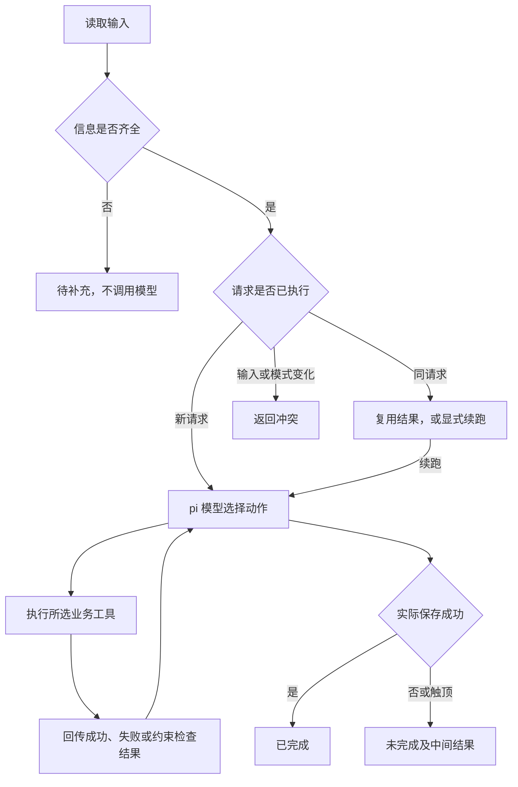

# 方案与技术取舍

## pi 承担的职责

使用精确版本 `@earendil-works/pi-agent-core@1.3.0` 和 `@earendil-works/pi-ai@1.3.0`。pi 的 `Agent` 承担消息上下文、模型响应、工具调用、结果回传和后续模型请求；pi-ai 负责自定义智谱 Provider、流式协议、模型认证及离线 Faux Provider。

本项目没有重新实现 Agent 循环。选择 Agent Core 是因为本题只需要四个业务工具，不需要编码助手的人设、文件编辑工具或资源自动发现。仅注册业务工具，模型不能使用 bash、read、edit 或 write。

官方参考：[Agent Core 1.3.0](https://github.com/earendil-works/pi/blob/v1.3.0/packages/agent/README.md)、[pi-ai 1.3.0](https://github.com/earendil-works/pi/blob/v1.3.0/packages/ai/README.md)、[智谱兼容接口](https://docs.bigmodel.cn/cn/guide/develop/openai/introduction)。版本选择与初始取舍见 [获批规划](../PLAN.md)。

## 调用流程

正常路径为检索、生成、估算、保存；这是提示中的业务依赖骨架，下一次具体工具、查询、档位、参数及停止仍由模型输出。估算工具根据数据表给出当前方案和全部备选的费用、耗时、超支与超期情况。

真实样例中，预算 10 的初稿为 premium、估算 12；模型收到结果后改为 balanced，重新生成、估算为 8、保存。将 balanced 的成本改成 20 后，真实模型选择 economy、费用 4。实际证据见 [真实运行汇总](../examples/real/summary.json)。

## 完成条件反馈

一次真实测试中，模型看到了费用表，却提前停止，忽略仍可行的候选。为此增加了可执行的完成条件校验：模型停止时，如果最后一次成功估算已返回可行候选、但尚未保存，运行时最多反馈一次已有候选和未完成状态。

反馈通过 pi 的 steering 队列进入上下文，模型继续决定下一步；代码不替模型指定档位或执行工具。反馈也受总轮数与超时限制。原始失败材料保留在 [observed-failures](../examples/observed-failures/changed-prices-before-feedback/check.json)，复现该缺陷的回归测试在 `tests/guards.test.ts`。

## 工具、状态与约束

| 模块 | 职责 |
| --- | --- |
| `src/model.ts` | 智谱 Provider、关闭内部思考输出的请求配置、错误文本脱敏 |
| `src/agent.ts` | pi 组装、执行上限、事件记录、完成条件反馈和权威任务状态 |
| `src/tools.ts` | 四业务工具、参数 Schema、实际尝试状态、成功结果保留和错误注入 |
| `src/domain.ts` | 输入和数据校验、费用与时间计算、内容指纹 |
| `src/store.ts` | JSON 检查点及方案文件保存 |
| `src/offline.ts` | 明确标记为模拟的确定性测试策略 |
| `src/cli.ts` | 输入、配置、运行入口及退出码 |

请求指纹包含规范化输入和模型模式/名称，另记录数据指纹。同一 ID 的输入、模式或数据变化会冲突，避免把离线结果当成真实模型结果，也避免复用旧费用表。已完成和未完成任务默认均复用历史结果，显式续跑才开启新一轮。

每次工具尝试前后保存状态；历史失败不会被后来的成功覆盖。稿件依赖已检索素材 ID，估算依赖稿件 ID，保存依赖同一稿件的有效估算。保存时重新计算约束，防止截止时间已过仍使用旧估算。

检查点采用临时文件和重命名；方案文件先完整写入临时文件，再用同目录硬链接原子创建唯一目标，已有同一方案可复用，不覆盖不同方案。此实现面向支持硬链接的普通本地文件系统；不支持时明确保存失败。请求状态未实现跨进程并发锁，也不承诺突然断电时的完整事务恢复。

Trace 仅保存公开动作依据、参数、工具返回、限制、公开结束说明和实际任务结果。内部 thinking 块不导出，认证信息不进入提示、Trace 或版本控制。`maxTurns=10`、`maxToolCalls=20`、`timeoutMs=120000` 都由代码执行；保存状态由实际文件回执决定。

## 有意保留的限制

素材检索为关键词匹配；脚本为事实约束的模板草稿。预算/耗时表是合成估算，未接真实报价、素材库和制作服务。模型仍可能作出低质量选择或在限制内无法完成，系统会返回未完成，而不伪造成功。离线测试和真实模型评估分别保存，不能相互替代。
